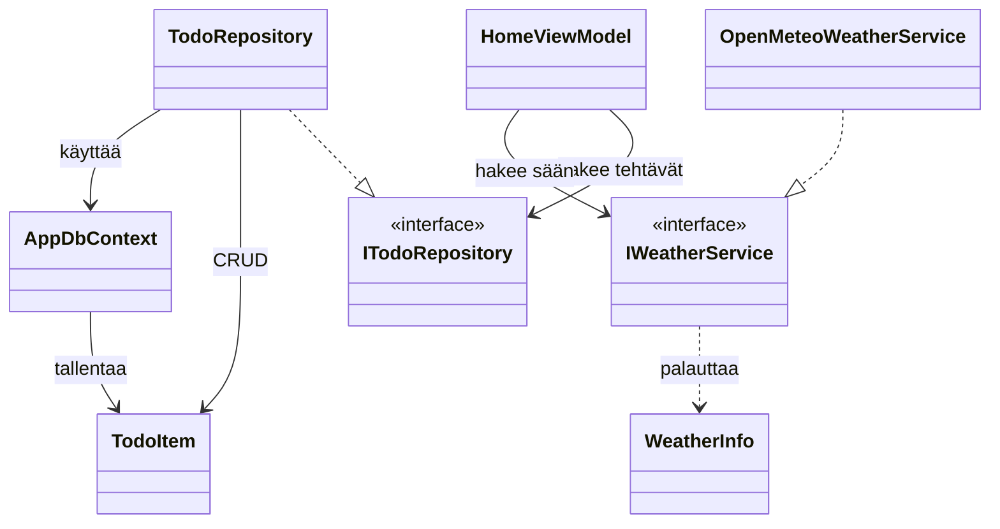

# LifeManagementApp

Tämä on CSP kurssin projektityö, joka tulee poistumaan kurssin päätyttyä


LifeManagementApp on .NET MAUI -sovellus arjen tehtävien hallintaan. Se kokoaa
tärkeimmät tehtävät ja tämänhetkiset säätiedot yhteen näkymään ja tallentaa
tehtävät laitteen paikalliseen SQLite-tietokantaan.

## Ominaisuudet

- **Top 3:** etusivu näyttää enintään kolme tärkeintä tehtävää
  prioriteettijärjestyksessä. Saman prioriteetin tehtävät järjestetään
  eräpäivän mukaan.
- **Sää:** etusivulla näytetään Open-Meteosta haettu tämänhetkinen lämpötila ja
  tuulen nopeus.
- **Kitesurf-huomio:** sovellus näyttää kitesurf-huomion, kun tuulen nopeus on
  yli 5 m/s.
- **Todo-lista:** tehtäviä voi lisätä, merkitä tehdyiksi ja poistaa. Tehtävällä
  on otsikko, prioriteetti (1–5) ja valinnainen eräpäivä.
- **Lajittelu:** tehtävälistan voi järjestää prioriteetin tai eräpäivän mukaan.
  Eräpäivän mukaan järjestettäessä menneet eräpäivät rajataan pois.

## Vaatimukset ja käynnistys

- .NET 10 SDK
- .NET MAUI -työkuorma


Kloonaa projekti ja asenna tarvittava MAUI-työkuorma:

git clone https://github.com/btekki/LifeManagementApp.git
cd LifeManagementApp
dotnet workload install maui
dotnet restore
dotnet build .\LifeManagementApp.csproj -f net10.0-windows10.0.19041.0

## Rakenne

```text
LifeManagementApp/
├── Data/          # EF Core -tietokantakonteksti
├── Models/        # Tehtävä- ja säätietomallit
├── Services/      # Tehtävärepository ja sääpalvelu
├── ViewModels/    # Näkymien tila ja sovelluslogiikka
├── Views/         # MAUI-näkymät (XAML)
├── Platforms/     # Alustakohtainen käynnistys ja asetukset
├── Resources/     # Kuvakkeet, kuvat, fontit ja tyylit
├── App.xaml
├── AppShell.xaml
├── MauiProgram.cs
└── LifeManagementApp.csproj
```

## Luokkien suhteet



## Säärajapinta

Sääpalvelu käyttää Open-Meteon ennusterajapintaa:

```text
https://api.open-meteo.com/v1/forecast
```

Kutsu sisältää seuraavat parametrit:

| Parametri | Arvo tai tarkoitus |
|---|---|
| `latitude` | Leveysaste |
| `longitude` | Pituusaste |
| `current` | `temperature_2m,wind_speed_10m` |
| `wind_speed_unit` | `ms` (metriä sekunnissa) |

Etusivun nykyiset koordinaatit ovat koodissa `74.26, 19.02`, koska kyseisessä paikassa tuulee usein. Vähän kylmä voi toki olla.
Käyttäjä voi itse vaihtaa toivomansa koordinaatit etusivulla.

##Tekoälyn käyttö

Tekoälyä on käytetty apuna projektin suunnittelussa, issueiden luonnissa, virheiden etsimisessä ja korjauksessa sekä dokumentoinnissa.
Kaikki koodi on ihmisen kirjoittamaa ja siten ihmisen hyväksymää.
Tekoälynä käytössä on ollut Github Copilot, Copilot käyttämä malli on vaihdellut projektin aikana.